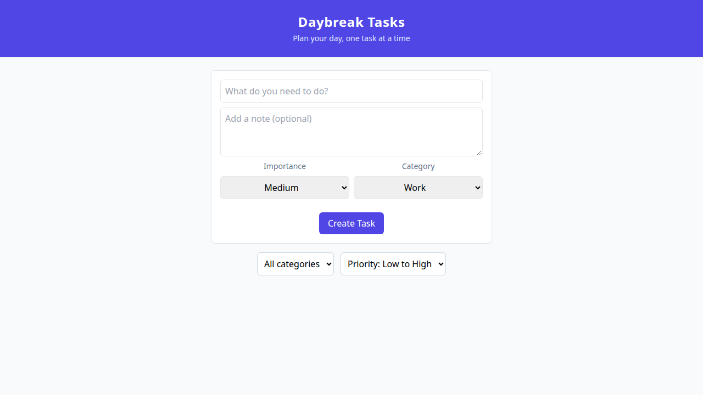

# Lab 10 findings

**Tester:** Mancos Alexandru · **File:** `tests/alexmn.spec.ts` · **Run:** `npx playwright test tests/alexmn.spec.ts` (Chromium, Playwright 1.65.1)

## My tests

| Test | Rule | Result |
|------|------|--------|
| the app loads and shows its heading | — | Pass |
| a new task appears in the list | — | Pass |
| the importance dropdown defaults to Medium | R4 | Pass |
| filtering by Home leaves only the Home task | Feature 5 (filter by category) | Pass |
| deleting one of two same-title tasks leaves the other | Feature 2 (delete) | **FAIL** |

Each of the four passing tests was also broken on purpose once (wrong heading name, wrong task title, `High` instead of `Medium`, wrong count). All four turned red, then I restored them.

## Failure: delete removes every task with the same title

- **Steps:** add "Call mom" twice, click Delete on the first one.
- **Expected:** 1 task left. **Received:** 0.
- **Failed line:** `await expect(page.locator('.task-item')).toHaveCount(1);` (spec line 50)
- **Evidence:**  — the page after the click, with no task card on it.
- **Same bug as:** BUG-04 in `bug-reports.md`.

## Trace questions

- **Cards Before and After the Delete click:** 2 before, 0 after.
- **Log of the final `toHaveCount(1)`:** it waited 5000 ms and every poll resolved to 0 elements ("unexpected value 0").
- **Network:** the trace lists only the page load (`index`, `App.tsx`, `TaskForm.tsx`, `TaskList.tsx`, React files). There is no request for the delete, so the app has no server and keeps its tasks in the browser.

## Root cause (from code)

`src/components/TaskList.tsx` line 113: the Delete button calls `onDeleteTask(task.title)`. `src/App.tsx`, `handleDeleteTasks()` (lines 39–41) keeps only tasks where `task.title !== title`. Two tasks with the same title are both removed. The `id` is different for each task and should be used instead.
