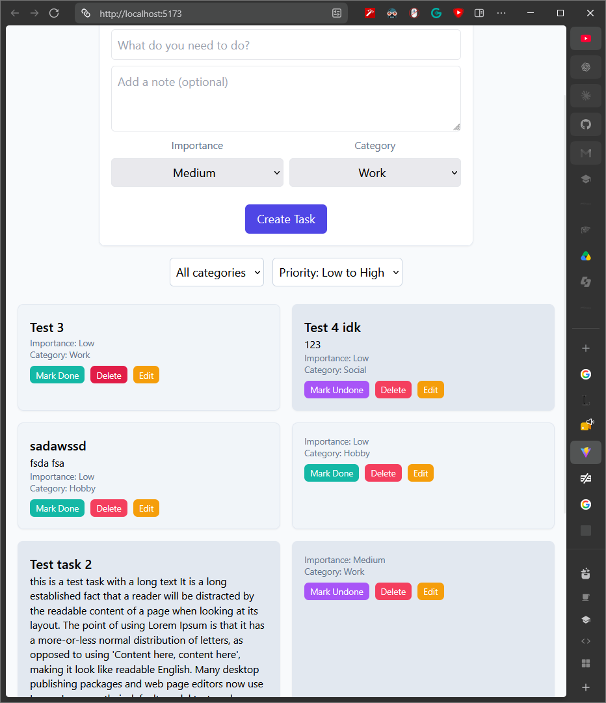
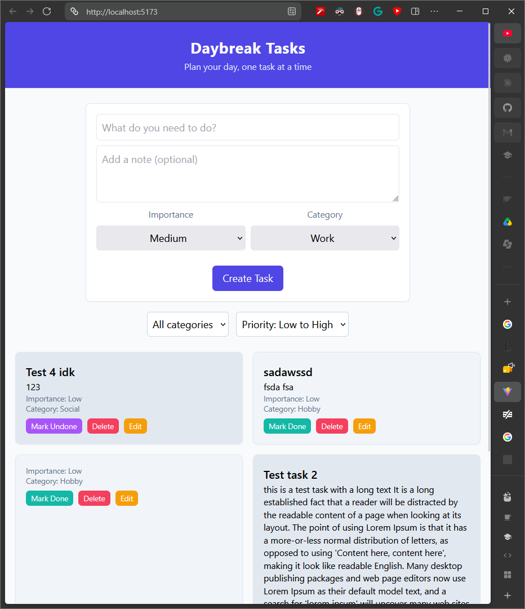
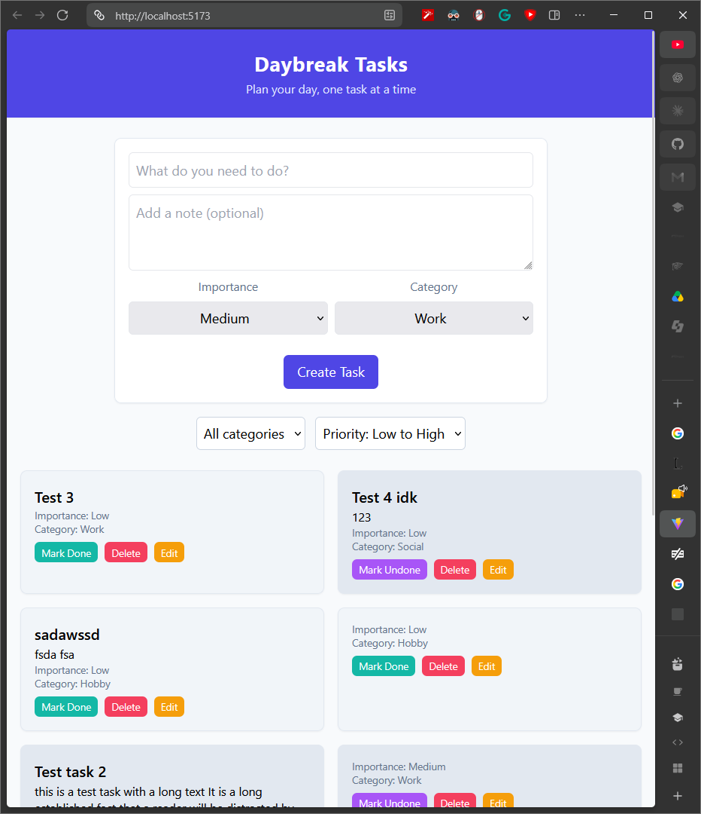

## BUG-01 · Task Deletion Functionality · Delete button doens't delete a task.
**Description:** Pressing Delete button on a specific task doens't actually delete a task. It appears again after a page refresh.
**Steps to reproduce:**
*Precondition*:
1.A task already exist in a dashboard

*Steps:*
1.Identify a task and press the `Delete` button on that task.
2.Refresh the page.
**Expected:** The deleted task disspaears from the list.   **Actual:** The deleted task appears again in the task list.
**Attachment:** 
Task List list before delition of task `Test 3`

Task List list after delition of task `Test 3`

Task List list after page refresh after delition of task `Test 3` 

**Severity:** High, this is a core functionality that doesn't work
**Priority:** P1, needs fixing before commiting