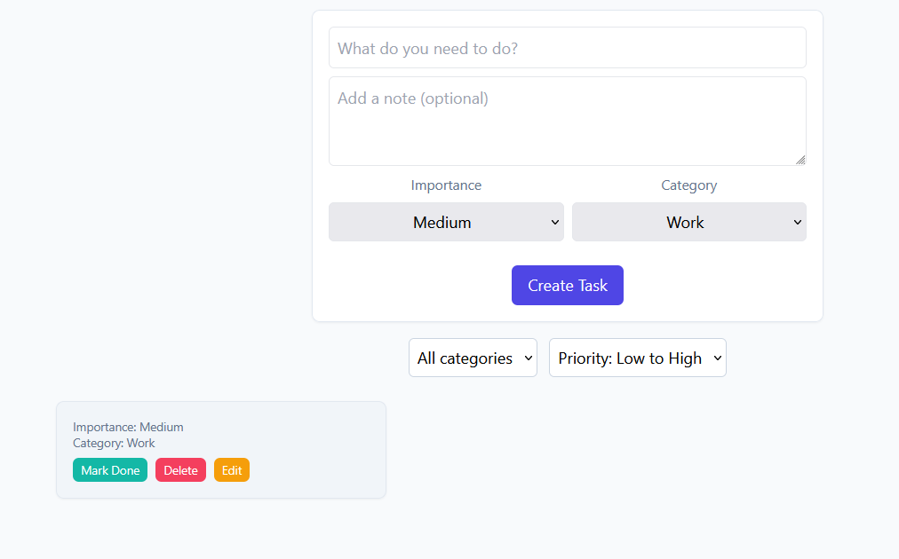

# Bug Report — Exploratory Testing

## BUG-01 · Task deletion · Deleted task reappears after page refresh

**Description:** Clicking `Delete` on a task removes it from the task list, but the deletion is not saved. After the page is refreshed, the deleted task appears in the list again.

**Environment:** Local build v0.0.0 (`npm run dev`), <http://localhost:5173>, [Zen browser (firefox) - Version 1.24.1b (64-bit)]

**Preconditions:**

1. The app is open in the browser.
2. At least one task exists in the task list.

**Steps to reproduce:**

1. Pick a task (e.g. `Test 3`) and click its `Delete` button.
2. Observe that the task disappears from the list.
3. Refresh the page.

**Expected result:** The deleted task stays removed after the page is refreshed.

**Actual result:** The deleted task is shown in the task list again.

**Attachments:**

Task list before deleting `Test 3`:

Task list right after deleting `Test 3` (the task is gone):

Task list after refreshing the page (`Test 3` is back):

**Severity:** High — deleting a task is a core feature, and it does not work.

**Priority:** P1 — must be fixed before release.

---

## BUG-02 · Task creation · Task can be created with an empty title

**Description:** Clicking `Create Task` while the title field is empty still creates a task. The new task has no title. This violates product requirement #1 ("Title and Importance are required").

**Environment:** Local build v0.0.0 (`npm run dev`), <http://localhost:5173>, [Zen browser (firefox) - Version 1.24.1b (64-bit)]

**Preconditions:**

1. The app is open in the browser.

**Steps to reproduce:**

1. Leave the title field ("What do you need to do?") empty.
2. Click the `Create Task` button.

**Expected result:** No task is created, and a validation message near the title field says the title is required.

**Actual result:** A task with an empty title is added to the task list.

**Attachments:**

Task with an empty title, created by following the steps above:

**Severity:** High — the app accepts invalid data that breaks a stated product requirement.

**Priority:** P1 — must be fixed before release.
