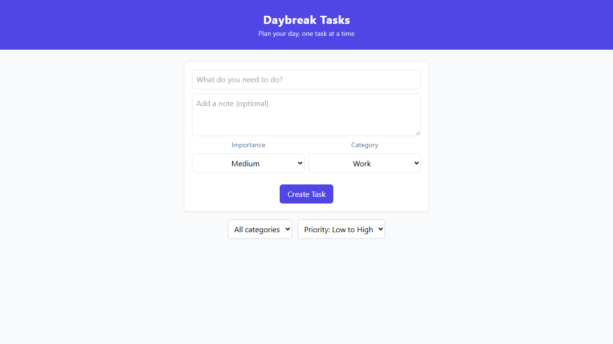

# Lab 10 findings

## My tests

| Test | Rule | Result |
|---|---|---|
| the app loads and shows its heading | — | Pass |
| a new task appears in the list | — | Pass |
| importance is Medium by default | R4 | Pass |
| category is Work by default | R5 | Pass |
| deleting one of two same-title tasks leaves the other | — | FAIL |

## Failure: delete removes every task with the same title

- Steps: add "Call mom" twice, click Delete on one.
- Expected: 1 task left.
- Received: 0 tasks left.
- Evidence: 
- Root cause: `TaskList.tsx` passes `task.title`; `App.tsx` filters by `task.title`.