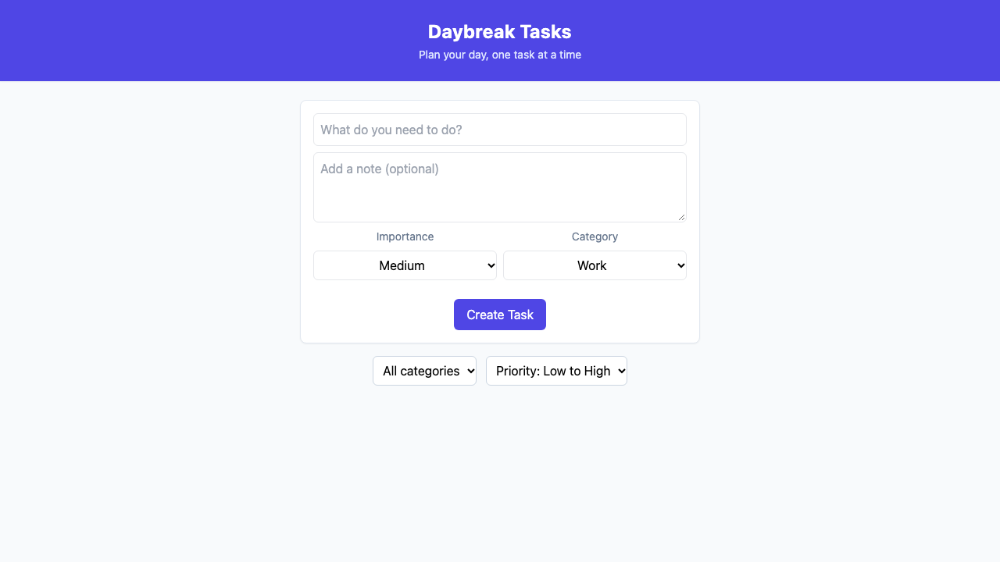

# Lab 10 findings

## My tests

| Test | Rule | Result |
| :--- | :--- | :--- |
| the app loads and shows its heading | — | Pass |
| a new task appears in the list | — | Pass |
| importance defaults to Medium | R4 | Pass |
| category defaults to Work | R5 | Pass |
| creating a task with High and Home shows them on its card | F1 | Pass |
| clicking Mark Done changes the button to Mark Undone | F4 | Pass |
| filtering by Home shows only the Home task | F5 | Pass |
| a created task is still there after reloading the page | F1 | Pass |
| deleting one of two same-title tasks leaves the other | F2 | FAIL |

## Failure: delete removes every task with the same title

- **Steps**: Add `"Call mom"` twice, then click **Delete** on the first task card.
- **Expected**: `1` task left (`.task-item` count = `1`). **Received**: `0`.
- **Evidence**:
  
- **Root cause**: `src/components/TaskList.tsx` (line 113) passes `task.title` instead of `task.id` (`onClick={() => onDeleteTask(task.title)}`), and `src/App.tsx` (lines 39–41) filters out all tasks matching that title (`tasks.filter(task => task.title !== title)`).
